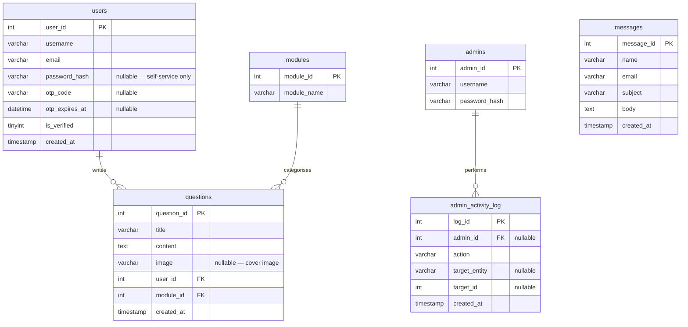
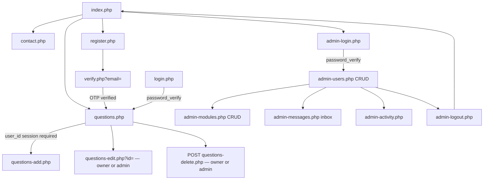

# ARCHITECTURE — Student Q&A CRUD System (COMP1841, procedural)

Technical blueprint for the coursework build. The app is a **plain procedural**
PHP + PDO + MySQL site — one script per page/action, free functions for data
access, no classes, no router. Diagrams here (ERD, navigation, request flow)
double as source material for the report's **Design** section.

> The report itself is the student's own work. This file documents *structure*,
> not prose to be copied into the report. The additional features beyond the
> lecturer's starter (hashed login, guarded admin area, dual validation, a real
> FK-constrained schema) are deliberate and must be declared in the report.

---

## 1. Purpose & scope
A prototype "student Q&A" site — a self-contained mini Stack Overflow. Students
view a list of questions, post/edit/delete a question (with an optional
screenshot), and contact the admin. A login-protected admin area manages the
authors and modules that questions are tagged to, and reads contact messages.

## 2. Technology stack
Framed as *technologies*, not tools (the brief marks technologies only):

| Technology | Role |
| --- | --- |
| **HTML5** | Semantic structure of every page; native form validation. |
| **CSS** | Presentation (`public/css/style.css`); consistent layout across pages. |
| **PHP (procedural + PDO)** | One script per page/action; all DB via PDO prepared statements through a shared `query()` helper. |
| **MySQL** | Relational store — 7 tables with foreign-key referential integrity. |

No MySQLi (brief caps at 40%). No third-party framework, no router, no classes
— every page is a script the student can read top to bottom. The one
exception is **PHPMailer** (via Composer, `composer.json`), used solely by
`includes/mailer.php` to send the self-service registration OTP over SMTP —
a discretionary feature (§3a), not a replacement for any of the four core
technologies above.

## 3. Why procedural (and what it adds beyond the lecturer's starter)
The lecturer's starter kit (`references/`) is procedural: one script per page,
a shared `query($pdo, $sql, $params)` helper, plain `include`d templates. This
build follows that same shape deliberately — no MVC layer on top — but fixes
three real weaknesses found in the starter kit, and keeps the schema/validation
work beyond it:

- **Guarded admin area.** The starter kit's `admin/*.php` pages have no auth
  check at all — reachable by anyone who knows the URL. Every `admin-*.php`
  page here starts with `require INCLUDES_PATH . '/require-admin.php';`, a
  `require` (not a function call) so it can't be forgotten the way the starter
  forgot to guard its own admin pages.
- **Hashed login.** The starter hardcodes a plaintext password
  (`$ActualPassword = "secret"`). This build stores admins in the `admins`
  table with `password_hash()` and checks with `password_verify()`.
- **Validated, safe uploads.** The starter moves `$_FILES['image']['name']`
  straight to disk with no checks. This build whitelists by extension *and*
  real image bytes (`getimagesize()`), caps size at 2 MB, and writes a
  generated filename — never the original.
- **A real relational schema.** 5 tables with enforced foreign keys (`ON
  DELETE RESTRICT`), vs. the starter's single unconstrained `post` table.
- **Dual validation.** HTML5 attributes client-side, full re-checks and
  friendly re-rendered errors server-side.

These — not an MVC layer — are the discretionary-mark "additional features"
declared in the report (see §13).

## 3a. Further discretionary features (beyond §3's four)
Two more discretionary features sit on top of §3's four, each declared
here (and to be declared in the report) per the brief's rule that additional
functionality beyond scope must be clearly identified:

| Feature | What it adds | Key files |
| --- | --- | --- |
| Self-service accounts | Public register/login with email-OTP verification via PHPMailer | `register.php`/`verify.php`/`login.php`/`logout.php`, `includes/mailer.php` |
| Admin activity log | Audit trail of admin logins + content changes | `admin_activity_log` table, `logAdminActivity()` |

See §6 (ERD), §7 (function inventory) and §8 (pages) for the full detail on each.

## 4. Directory structure
```
cw_web1/
├── cw_web1.sql                 schema + demo data (DB deliverable)
├── composer.json                declares phpmailer/phpmailer (run `composer install`)
├── .env.example                 SMTP_* placeholders — copy to .env (gitignored) and fill in
├── .gitignore                   excludes /vendor/ and /.env
├── config/
│   └── config.php              DB credentials + path/URL constants + .env loader + SMTP/OTP constants
├── includes/                   NOT web-addressable
│   ├── db-connect.php           builds the shared $pdo from config; starts the session
│   ├── db-functions.php         query() + one function per data operation (6 tables)
│   ├── require-admin.php        admin guard — require'd at the top of every admin-*.php page
│   ├── require-login.php        regular-user guard — require'd by questions-add.php
│   ├── validate.php             shared validation helpers (isBlank, validEmail, isConstraintViolation)
│   ├── upload.php                saveQuestionImage()/deleteQuestionImage()
│   └── mailer.php                sendOtpEmail() via PHPMailer/SMTP (needs vendor/ + .env)
├── templates/                   NOT web-addressable
│   ├── layout.php                public chrome (header/nav/footer, auth-aware)
│   ├── admin-layout.php          admin chrome (dark masthead, admin nav incl. Activity)
│   ├── home.php                  static hero + index
│   ├── questions-list.php        questions index + _qlist.php
│   ├── _qlist.php                 shared <ul class="qlist"> partial
│   ├── questions-form.php        shared add/edit form (question + cover image)
│   ├── contact-form.php          public "email admin" form
│   ├── register.php / verify.php / login.php   self-service account templates
│   ├── admin-login.php           full standalone pre-auth page (no layout wrapper)
│   ├── admin-users-list.php / admin-users-form.php
│   ├── admin-modules-list.php / admin-modules-form.php
│   ├── admin-messages-list.php   inbox table
│   ├── admin-activity.php        audit-log feed
│   ├── 404.php / 403.php         friendly not-found / not-allowed fragments
└── public/                     ← web root (point browser / server here)
    ├── index.php                home page (static, no DB query)
    ├── questions.php / questions-add.php / questions-edit.php / questions-delete.php
    ├── register.php / verify.php / login.php / logout.php   self-service accounts
    ├── contact.php
    ├── admin-login.php / admin-logout.php
    ├── admin-users.php / admin-users-add.php / admin-users-edit.php / admin-users-delete.php
    ├── admin-modules.php / admin-modules-add.php / admin-modules-edit.php / admin-modules-delete.php
    ├── admin-messages.php / admin-messages-delete.php
    ├── admin-activity.php       audit-log feed (guarded)
    ├── .htaccess                Options -Indexes only — no rewriting, pages are addressed directly
    ├── css/style.css
    └── images/                  uploaded screenshots
vendor/                          NOT committed — created by `composer install` (phpmailer/phpmailer)
```
`includes/`, `templates/` and `config/` sit outside `public/`, so no PHP logic
or credential file is web-addressable — only `public/` is served.

## 5. Request lifecycle
There is no front controller — each page in `public/` is requested directly
(`questions.php`, `questions-edit.php?id=5`, `admin-modules-delete.php`
POST-only, …). Every page follows the same shape:

```php
// public/questions.php
require dirname(__DIR__) . '/config/config.php';
require INCLUDES_PATH . '/db-connect.php';      // $pdo + session_start()
require INCLUDES_PATH . '/db-functions.php';

$questions = allQuestions($pdo);                // the page's own try/catch around this

$title = 'Questions';
ob_start();
require TEMPLATES_PATH . '/questions-list.php'; // page content
$output = ob_get_clean();
require TEMPLATES_PATH . '/layout.php';         // echoes $title + $output
```
This is the taught `ob_start()` / buffer / layout idiom, unchanged from the
lecturer's starter — just given a `$title`/`$output` pair per page instead of
per-view. Guarded admin pages add one line before the DB call:
```php
require INCLUDES_PATH . '/require-admin.php';   // redirects to admin-login.php + exit if not logged in
```
Pages restricted to a logged-in self-service user (`questions-add.php`) use
the equivalent `includes/require-login.php` (checks `$_SESSION['user_id']`).
`questions-edit.php` and `questions-delete.php` accept *either* an admin or
the question's own author — see §9.

Filesystem includes use `__DIR__`-based absolute path constants
(`INCLUDES_PATH` / `TEMPLATES_PATH`, defined in `config.php`) so they never
depend on the server's working directory or a page's location.

`public/.htaccess` only sets `Options -Indexes` (no directory listings) — there
is no rewrite rule, since navigation is plain `<a href="questions-edit.php?id=5">`
links, matching the taught pattern rather than clean URLs.

## 6. Entity-Relationship Diagram

`questions.user_id → users.user_id` and `questions.module_id → modules.module_id`
are enforced foreign keys (InnoDB), declared **`ON DELETE RESTRICT`**: an author
or module that still owns questions cannot be deleted — demonstrable referential
integrity. `messages` is standalone (no FKs).

One more FK was added for the discretionary activity log, a deliberate
contrast to the RESTRICT above:
- `admin_activity_log.admin_id → admins.admin_id`, **`ON DELETE SET NULL`**
  — the audit trail survives even if the admin account that performed the
  action is later removed.

`users` also gained `password_hash`/`otp_code`/`otp_expires_at`/`is_verified`
(self-service accounts, §9b).

## 7. Data access — `includes/db-functions.php`
One free function per operation, `$pdo` always first, every SQL statement
through the shared `query()` helper with named `:placeholders` — the taught
idiom, kept exactly as taught rather than promoted to a class method:
```php
function query($pdo, $sql, $parameters = []) {
    $stmt = $pdo->prepare($sql);
    $stmt->execute($parameters);
    return $stmt;
}
```
Function inventory (all SQL parameterised, no SQL anywhere else — pages or templates):

| Entity | Functions |
| --- | --- |
| `questions` | `allQuestions` (3-table JOIN), `getQuestion`, `insertQuestion`, `updateQuestion`, `deleteQuestion` |
| `users` | `allUsers`, `allUsersWithCounts`, `getUser`, `insertUser`, `updateUser`, `deleteUser` |
| `users` (self-service) | `findUserByEmail`, `findUserByUsername`, `findUserForLogin`, `insertPendingUser`, `setUserOtp`, `markUserVerified` |
| `modules` | `allModules`, `allModulesWithCounts`, `getModule`, `insertModule`, `updateModule`, `deleteModule` |
| `messages` | `allMessages`, `insertMessage`, `deleteMessage` |
| `admins` | `findAdminByUsername` |
| `admin_activity_log` | `logAdminActivity`, `allActivityLog` |

`updateQuestion` writes title/content/image/user/module (full parity — the
lecturer's starter only updated title/content). `allModulesWithCounts` uses
a `LEFT JOIN ... COUNT(...)` so the admin list can show usage and disable the
delete button for anything still in use — modules hard-delete under FK
RESTRICT. `allUsersWithCounts` also joins a count, purely informational.
Both `deleteUser` and `deleteQuestion` are hard `DELETE`s; `deleteUser` can
throw a `PDOException` (SQLSTATE 23000) if the user still authored questions,
caught by `admin-users-delete.php` via `isConstraintViolation()` — the same
demonstrable-referential-integrity pattern already used by `deleteModule`.

`allActivityLog($pdo, $limit = 50)` accepts a `$limit` integer that is cast
with `(int)` and interpolated directly into the SQL: binding `LIMIT` as a
named parameter is unreliable under real prepares, so the established, safe
idiom here is a validated integer cast rather than a bound placeholder — the
value never comes from user input.

## 8. Pages (request layer) & routes
| Page(s) | Purpose |
| --- | --- |
| `index.php` | Home (static). |
| `questions.php` | List every question (JOIN). |
| `questions-add.php` | GET form / POST insert *(requires login as a self-service user)*. |
| `questions-edit.php?id=` | GET form / POST update *(question's own author, or admin)*. |
| `questions-delete.php` | POST-only delete *(own author, or admin)*. |
| `register.php` → `verify.php?email=` → `login.php` / `logout.php` | Self-service account: register, OTP-verify, log in/out. |
| `contact.php` | GET form / POST insert (public — no login needed). |
| `admin-login.php` / `admin-logout.php` | Auth. |
| `admin-users.php` + `-add` / `-edit` / `-delete` | Manage authors *(guarded)*. |
| `admin-modules.php` + `-add` / `-edit` / `-delete` | Manage modules *(guarded)*. |
| `admin-messages.php` / `admin-messages-delete.php` | Inbox *(guarded)*. |
| `admin-activity.php` | Audit-log feed *(guarded)*. |

Every add/edit page validates input, and re-renders its own form with
`$errors`/`$old` on failure rather than redirecting — the same pattern for
every entity, procedural rather than a shared `renderForm()` method.

## 9. Admin area & auth model
- `admin-login.php` (POST branch): `findAdminByUsername($pdo, $username)`, then
  `password_verify()` against the stored `password_hash`. On success
  `session_regenerate_id(true)` and set `$_SESSION['admin_id']`/`admin_name`,
  redirect to `admin-users.php`.
- `includes/require-admin.php` — `require`d as the first line of every
  `admin-*.php` page:
  ```php
  if (empty($_SESSION['admin_id'])) {
      header('Location: admin-login.php');
      exit;
  }
  ```
  The `exit;` matters — without it the guarded page keeps running after the
  redirect header. Being a `require` rather than a function call means it
  can't be silently skipped the way the lecturer's starter forgot to guard
  its own admin pages.
- `admin-logout.php`: logs the `logout` action, clears `$_SESSION` and
  `session_destroy()`, redirects to the public home page.

## 9a. Content ownership model (self-service users vs. admin)
Two independent session identities coexist: `$_SESSION['admin_id']` (site
admin, manages users/modules/messages) and `$_SESSION['user_id']` (a
self-service author, can post/edit/delete their own questions). Neither page
requires both — `questions-edit.php`/`-delete.php` accept *either*:
```php
$isAdmin = !empty($_SESSION['admin_id']);
$isOwner = !empty($_SESSION['user_id']) && (int) $_SESSION['user_id'] === (int) $question['user_id'];
if (!$isAdmin && !$isOwner) { /* 403 */ }
```
`questions-add.php` is stricter — only a logged-in self-service user may
create a question (`includes/require-login.php`, checking `user_id` only);
the admin account itself never authors content, only moderates it. This
preserves the brief's "assign to module + user via dropdown" requirement two
ways: the self-service form auto-fills the author from the session (module
dropdown only), while the *admin* edit path (`$isAdminEditing` in
`questions-form.php`) still shows both dropdowns and can reassign any
question to any author/module.

## 9b. Self-service accounts + email OTP (discretionary)
`register.php` creates an unverified row (`is_verified = 0`, a hashed
password, a 6-digit `otp_code` + `otp_expires_at` ten minutes out) and calls
`sendOtpEmail()` (`includes/mailer.php`, PHPMailer over SMTP — see composer.json
+ `.env.example`). If sending fails (e.g. `.env` not filled in yet), the code
is shown on-screen as a one-time session flash so the flow stays testable
without real email. `verify.php` checks the submitted code with
`hash_equals()` against the stored code and expiry, then calls
`markUserVerified()` and logs the user in (`session_regenerate_id(true)`,
`$_SESSION['user_id']`). `login.php` looks the account up by username *or*
email (`findUserForLogin()`), `password_verify()`s, and refuses unverified
accounts (redirecting back to `verify.php`). Admin-added authors
(`admin-users-add.php`) are inserted with `is_verified = 1` and no password —
they remain pure metadata rows unless the same person separately registers.

## 9c. Admin activity/audit log (discretionary)
`logAdminActivity($pdo, $adminId, $action, $entity, $targetId)` is called
from every admin login/logout and every admin create/update/delete across
users, modules, messages and questions, writing one row to
`admin_activity_log`. `admin-activity.php` (guarded) lists the most recent
100 entries. The FK to `admins` is `ON DELETE SET NULL` so the trail outlives
the admin account that produced it.

## 10. Security & validation
- **SQL injection** — every query is a PDO prepared statement via `query()`.
- **XSS** — all displayed data escaped with `htmlspecialchars(…, ENT_QUOTES, 'UTF-8')`.
- **Passwords** — admin *and* self-service user passwords stored as
  `password_hash()` output; never plain. OTP codes are compared with
  `hash_equals()` (constant-time) rather than `===`.
- **Uploads** — whitelist extension (jpg/jpeg/png/gif) *and* verify real image
  bytes via `getimagesize()`; size cap; generated filename (never the
  original), moved into `public/images/` via `move_uploaded_file`.
- **Secrets** — SMTP credentials live only in `.env` (gitignored, never
  committed); `config.php` reads them via a minimal hand-rolled parser and
  falls back to empty constants if `.env` is absent, so a missing file fails
  closed (`sendOtpEmail()` returns `false`) rather than fataling the site.
- **Content ownership** — `questions-edit.php`/`-delete.php` check the acting
  session (admin or the question's own author) before any write; see §9a.
- **Validation layers**:
  - *Client* — HTML5 `required`, `type="email"`, `maxlength`, `accept` on file.
  - *Server* — non-empty checks, `filter_var($e, FILTER_VALIDATE_EMAIL)`, `(int)`
    cast on all ids, re-render the same page with error messages on failure.
- **Directory protection** — `includes/`, `templates/`, `config/` and `vendor/`
  live outside the web root (`public/`).

## 11. Accessibility (brief-required, W3C)
Semantic landmarks (`header`/`nav`/`main`/`footer`); every input paired with a
`<label for>`; `alt` text on all images; keyboard-visible focus styles; adequate
colour contrast; a page `<title>` per view; `lang` on `<html>`.

## 12. Navigation structure


## 13. Requirement → component → marks traceability
| Requirement (brief) | Marks | Delivered by |
| --- | --- | --- |
| Display list of questions | 10 | `questions.php` + `allQuestions()` JOIN + `templates/questions-list.php` |
| Add / edit / delete a question | 7 | `questions-add.php` / `questions-edit.php` / `questions-delete.php` |
| Image per question | 3 | `includes/upload.php`, rendered in `templates/questions-list.php` / `questions-form.php` |
| Email admin via web form | 3 | `contact.php` → `messages` + `admin-messages.php` inbox |
| Add/edit/delete users + link to posts | 7 | `admin-users*.php` + `questions.user_id` FK |
| Assign post to module + user via dropdowns | 3 | selects in `templates/questions-form.php` (module always; author dropdown for admin edits, auto-filled from session for self-service — §9a) |
| Add/edit/delete modules | 7 | `admin-modules*.php` + `questions.module_id` FK |
| Additional (§3): hashed login, guarded admin area, dual validation, FK-constrained schema | 30 (disc.) | `includes/require-admin.php`, `password_hash`/`password_verify` in `admin-login.php`, client+server validation on every add/edit page, `ON DELETE RESTRICT` FKs |
| Further discretionary (§3a): self-service OTP accounts, admin activity log | — | see §3a table |
